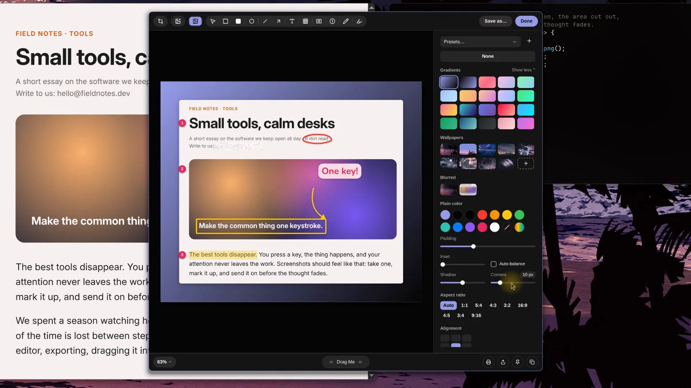

# Snip

Snip is a screenshot and screen recording tool for [Omarchy](https://omarchy.org) and Hyprland, modelled on CleanShot X.

See it at work on [snipshotx.com](https://snipshotx.com).



## Features

- **Capture**: an area, a window, the whole screen or the previous area. The screen freezes when you press the shortcut, and a magnifier shows the pixel under the pointer and its hex colour. Window captures keep Hyprland's rounded corners and get a shadow on your wallpaper.
- **Quick Access**: every capture appears as a card in the corner. Copy, save, annotate or pin it from there, or drag it into another app.
- **Editor**: arrows (drag the middle to bend one), text in seven styles, counters, rectangles, ellipses, lines, a pen, a highlighter that snaps to lines of text, spotlight, crop and resize. Pixelate, Blur and Black out hide what's under them in the saved image.
- **Backgrounds**: a gradient, one of your wallpapers, a blur or a plain colour behind the capture, with padding, rounded corners, a shadow and an aspect ratio.
- **Scrolling capture**: select an area and scroll, or let Auto-Scroll do it. Snip stitches the frames into one tall image.
- **Capture Text**: copies the text in an area to the clipboard, or the link in a QR code. Recognition runs locally with Tesseract.
- **Pins**: keep a capture above your windows. Scroll over it to change its opacity, Ctrl+scroll to resize it.
- **Recording**: an area, a window or a monitor, as a video or a GIF. Add the microphone, the computer's sound, a camera, and your clicks and keystrokes.
- **Studio**: records the pointer apart from the screen. When you stop, the video editor opens with zooms at your clicks and typing, the view following the pointer, and a redrawn pointer you can enlarge and smooth. The editor also trims, cuts and exports MP4 or GIF.
- **History**: every capture is kept with the text recognised in it. Search it in the History window or with `snip search`.
- **Hide desktop clutter**: covers the bar with your wallpaper for a clean shot.
- **Omarchy**: Snip follows your theme, has an icon in the bar and actions in the launcher.

Captures are saved as PNG, JPG or WebP. Everything stays on your computer.

## Install

Snip runs on Omarchy, or Arch Linux with Hyprland.

```sh
curl -fsSL https://snipshotx.com/install.sh | bash
```

This builds a pacman package from source, installs it, and starts Snip now and at every login. Run it again to update. To uninstall:

```sh
curl -fsSL https://snipshotx.com/install.sh | bash -s remove
```

From a checkout, `scripts/install.sh` does the same, and `scripts/install.sh remove` uninstalls.

Capture Text needs `tesseract-data-eng`, and the microphone level needs `pipewire-audio`. Omarchy has both.

## Usage

On first start, a Welcome window offers to add Snip's keys to your Hyprland config, and Print Screen too if you want it.

| Keys | Action |
|---|---|
| Super + Shift + 3 | Capture the whole screen |
| Super + Shift + 4 | Capture an area (press Space for a window) |
| Super + Shift + 5 | All-In-One |
| Super + Shift + 6 | Edit the image on the clipboard |

Every action is also a command, so you can bind it to any key or use it in scripts:

```sh
snip area            # capture an area
snip window          # capture a window
snip text            # copy the text in an area
snip scroll          # scrolling capture
snip record          # record an area; run it again to stop
snip history         # browse past captures
snip search TEXT     # find captures by their text
snip edit FILE       # open an image in the editor
snip settings        # open Settings
```

`snip --help` lists every command.

## Configuration

The Settings window writes `~/.config/snip/config.toml` and keeps your comments. Edits made by hand apply immediately. Settings › Shortcuts records keys for any action.

## Development

```sh
sudo pacman -S --needed rust cmake ninja corrosion qt6-base qt6-declarative qt6-wayland qt6-multimedia qt6-multimedia-ffmpeg qt6-shadertools layer-shell-qt kcoreaddons sqlite ffmpeg tesseract tesseract-data-eng

scripts/dev.sh          # build, then run snipd from build/ as the user unit snip-dev
scripts/dev.sh stop     # stop it and give Hyprland its own bindings back
cargo test -p snip-core -p snip-ipc -p snip-hypr -p snip_bridge
```

[docs/00-README.md](docs/00-README.md) has the decision log and the map of the spec, architecture and roadmap. Every merge to `main` is published as a release.

## Credits

Snip follows the workflow of [CleanShot X](https://cleanshot.com) for macOS. It is an independent project and isn't affiliated with CleanShot X or its makers.

Created by [InsaneArts](https://insanearts.io).

## License

GPL-3.0-or-later. See [LICENSE](LICENSE). The editor's Rounded text styles use [Nunito](https://github.com/googlefonts/nunito) (SIL Open Font License, `app/fonts/OFL-Nunito.txt`).
