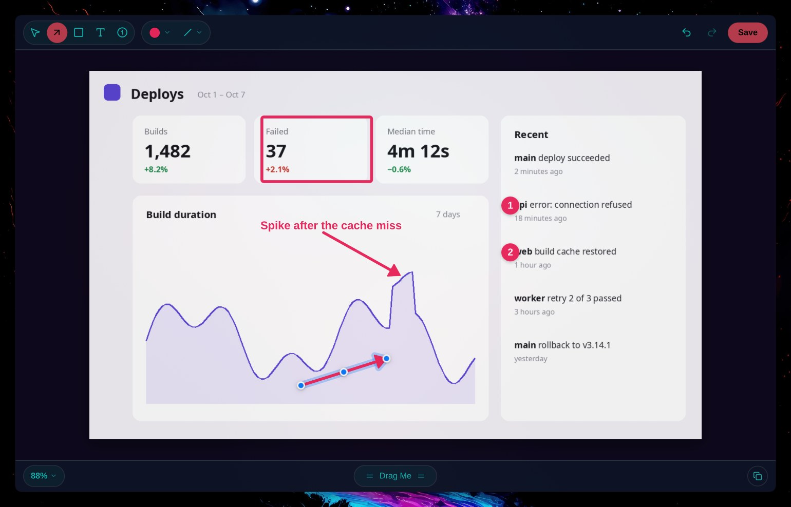
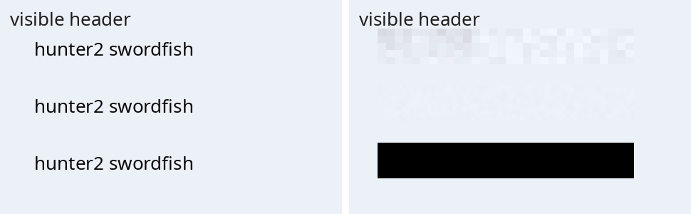
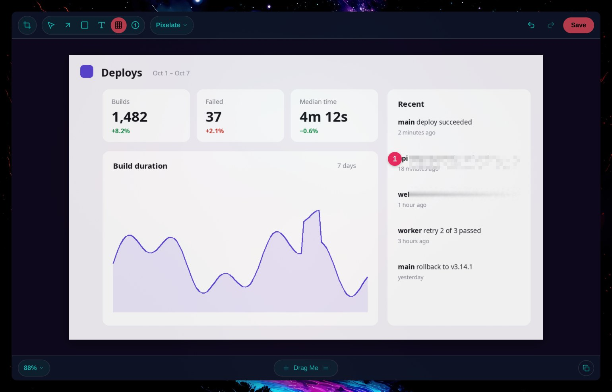
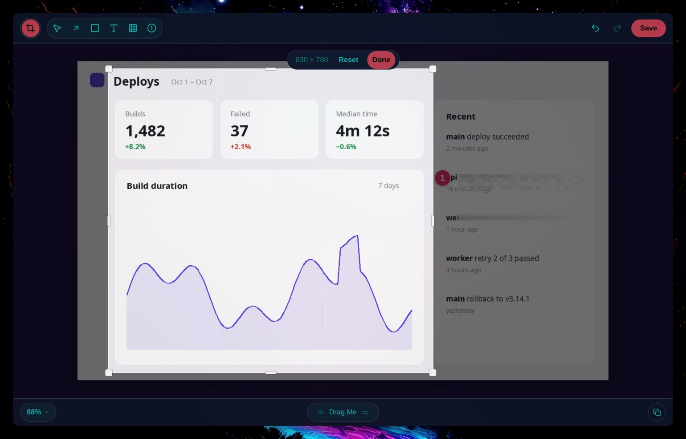

# The editor (Annotate), as CleanShot does it

Source: cleanshot.com's `markup.mp4` demo (1700×1200, 60 fps, 27.6 s), studied frame by frame on 2026-10-07. Spec: ANN-01…19. Decisions: D26 (secure Pixelate/Blur).

## Layout

```
┌──────────────────────────────────────────────────────────────────────┐
│ (crop)(+img)(bg) │ ➤ □ ■ ○ ╱ ↙ (A) ▦ ▭ ❶ ✎ ◎ │ ●▾  20 pt▾  A▾   [Save as…] │  toolbar
├──────────────────────────────────────────────────────────────────────┤
│                                                                      │
│                    the image, on a light backdrop                    │  canvas
│                                                                      │
├──────────────────────────────────────────────────────────────────────┤
│ 100% ▾                  ≡ Drag Me ≡                 ⟲  ⇪  📌  ⧉  ☁  │  bottom bar
└──────────────────────────────────────────────────────────────────────┘
```

- **Toolbar:** a light bar (`#ebe0ea` over the wallpaper tint).
  - Tools sit in white capsule groups with thin separators.
  - The selected tool is a filled blue circle (`#006dff`) with a white glyph.
  - Each tool keeps its own options. The options group changes with the tool: colour swatch with a chevron, stroke width (line glyph), "20 pt" for text, "123" style for counters, a lock for crop.
- **Save as…:** the blue primary button, top right.
- **Bottom bar:** slightly darker (`#d3cbd4`).
  - Zoom percentage dropdown (left).
  - "Drag Me" pill with grip lines (centre): drags the result out.
  - Action circles (right): rotate, share, pin, copy, cloud.

## Objects
- **Arrow:** pink-red `#f1285f` by default.
  - Thick rounded stroke and a filled triangular head about 3.2× the stroke wide.
  - Drawn straight. Dragging its middle bends it into a curve; there is no separate curved tool.
  - Selected: a pale blue halo around the whole shape, plus solid blue handle dots (`#0177ff`, white ring) at both ends; the middle handle appears on hover.
- **Text:** bold, in the current colour.
  - While typing: a pale blue box with a blue caret and handles on the left and right edges (wrap width), and a square at the bottom right (size).
  - A blue smiley above the box opens emoji.
- **Counter:** a filled circle in the current colour with a white bold number, about 1.6× the text cap height, with a soft shadow. Clicks add 1, 2, 3…
- **Highlighter:** a translucent yellow band.
- **Colour dropdown:** a vertical white capsule under the swatch.
  - Ten swatches: black, red, orange, yellow, green, teal, blue, purple, pink, white.
  - A rainbow "custom" swatch below a hairline.
  - The current colour has a ring.

## Motion
- Tool switches and selection halos are instant.
- Dropdowns fade and drop in about 120 ms.
- Zoom animates (about 200 ms) when changed from the menu or keys; it is direct under the pointer with Ctrl+scroll.

## Snip's take (first slice)



- Same layout and object look, themed. Chrome comes from Omarchy theme tokens: surface, text, accent for the selected tool and the primary button. The annotation palette is CleanShot's ten colours, with pink as the default.
- Hyprland draws the window frame, so Snip has no traffic lights.
- Tools: Select (V), Arrow (A), Rectangle (R), Text (T), Counter (N), Pixelate/Blur/Black out (P, D26), Crop (C).
- Primary button: **Save** (Ctrl+S, export folder plus clipboard, §5.0). Bottom right: Copy (Ctrl+Shift+C, closes the editor).
- Edits go back to the capture's history entry automatically (ANN-15).
  - The capture keeps its original and its objects next to it (`original.png`, `edit.json`), so reopening keeps everything editable (ANN-16).
  - Rotating or flipping a capture flattens it.
- Export is the same scene rendered offscreen at native size (`Platform.grabExact`), so the preview equals the export (spike S05).

### Pixelate / Blur (D26)

The look comes from the pixels around the region, never from what is under it:
- the four sides' colours are blended across the region;
- seeded noise is added (big tiles for Pixelate, small smoothed ones for Blur);
- Black out is a plain fill.



 

## Full parity (target, 2026-10-07)

The product owner asked for CleanShot's Annotate with every feature and option, as accurately as possible. The sources are a dark-mode screenshot of CleanShot 5 on macOS (2034×1350 @2x) and the inventory (research doc §4).

**Toolbar, left to right** (dark mode; sizes in points):
- **Window controls**, then three single-button capsules:
  - Crop & Resize (K)
  - Add image (⌘I / ⇧⌘I)
  - Background (B)
- **One capsule with every tool:**
  - Select (V), Rectangle (R), Filled rectangle (F), Ellipse (E), Line (L), Arrow (A), Text (T), Pixelate (P), Spotlight (H), Counter (C), Pencil (D), Highlighter (M).
  - Hairline separators between tools.
  - The selected tool is a **rounded rectangle** in the accent colour (about 35×23 pt, radius about 7), with a white glyph.
- **Colour capsule:** a swatch dot and a chevron. **Size capsule:** a stroke glyph and a chevron.
- **Right:** "Save as…" (a grey capsule), then **Done** (an accent capsule). Done writes the edits back and closes.

**Colours measured** (dark): toolbar `#1a191d`; capsules `#313135`; accent `#e7584b` (that Mac's accent). Snip takes surface, capsule and accent from the Omarchy theme.

**Bottom bar:**
- Zoom capsule ("100%" and a chevron) on the left.
- "Drag Me" capsule in the centre.
- Round icon buttons on the right: share, pin, copy, cloud.
- Snip has no cloud (decision D3); share and pin come with their features.

**Tools and options to build** (spec ANN-01…18):

| Tool | Options |
|---|---|
| Select | Handles; Shift locks an axis; Alt-drag duplicates; Ctrl+C/V objects (also between images); Ctrl+D; Delete |
| Rectangle, Filled, Ellipse, Line | Colour, thickness, Shift for perfect shapes or straight lines, object shadow, corner roundness |
| Arrow | Standard, Fancy, Curved, Double; thickness; Alt while drawing inverts the direction |
| Text | Standard, Box, Rounded, Rounded Box, Outline, Monospaced, Monospaced Box; size; drag the corner to wrap; emoji |
| Pixelate | Pixelate (secure), text-shaped blocks, Blur, Black out; intensity |
| Spotlight | Rounded rectangle or ellipse; dim amount |
| Counter | 1,2,3 / A,B,C / I,II,III; start number; size; renumbers itself; always on top |
| Pencil | Smoothing |
| Highlighter | Snaps to text lines (OCR boxes); opacity |
| Crop & Resize | Ratios, snap to edges, outward crop grows the canvas, rotate, flip, resize in px or % |
| Add image | File, paste, new screenshot; drop zones; the canvas grows |
| Background | Presets, gradients, wallpapers (Omarchy themes), blurred, plain; padding, inset, auto-balance, shadow, corners, ratio, alignment |
| Colours | 10 swatches, 10 saved colours, saturation/brightness square, hue, alpha, hex and RGB, eyedropper |
