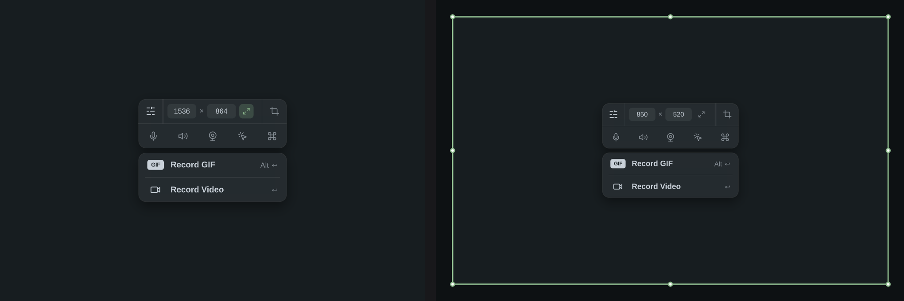
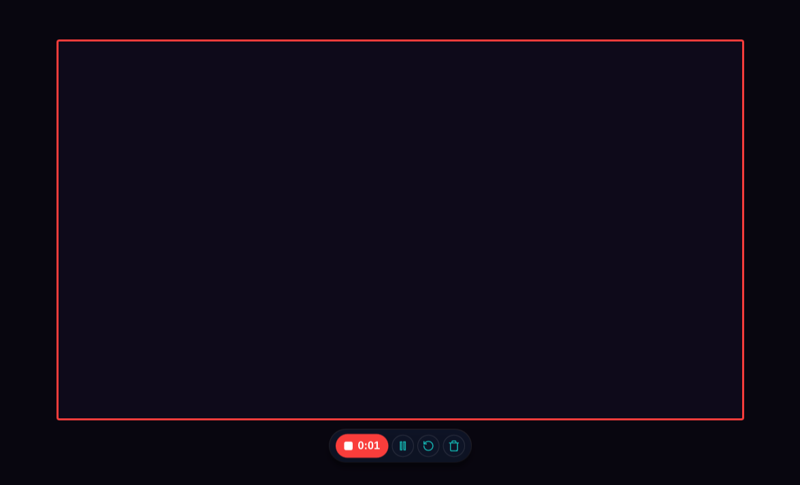
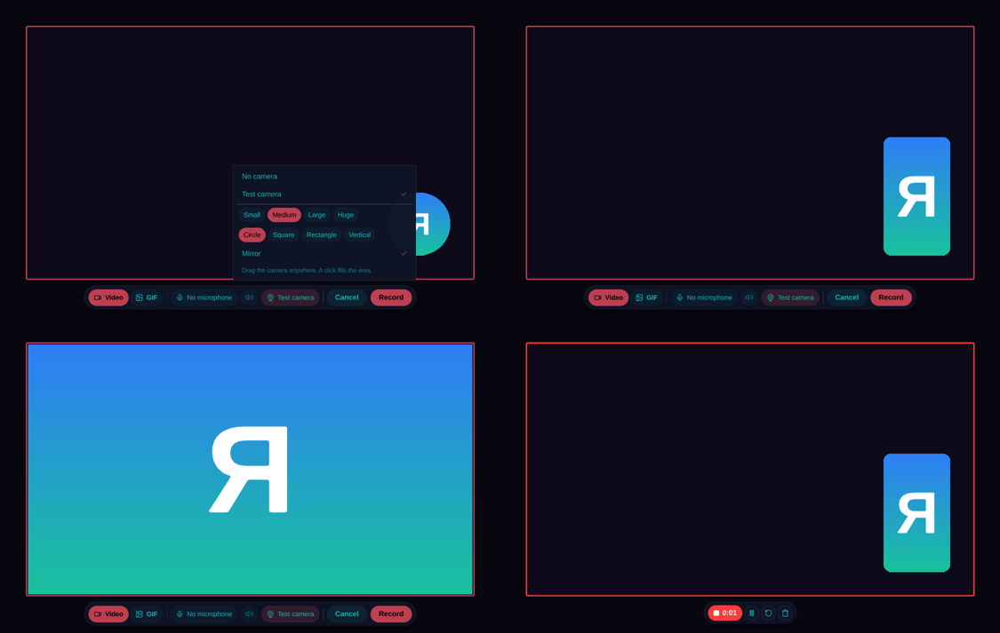
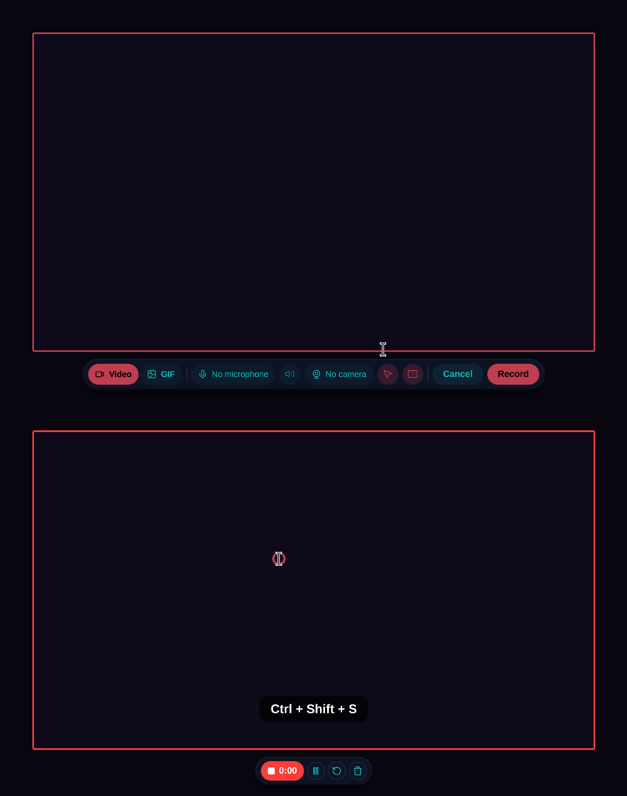
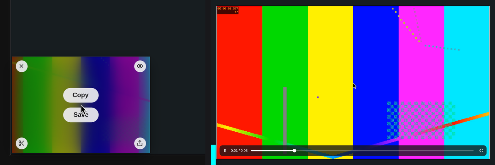
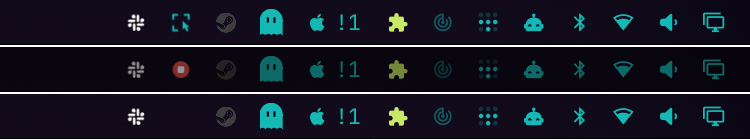
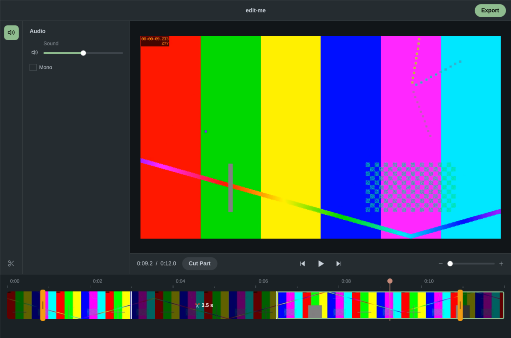
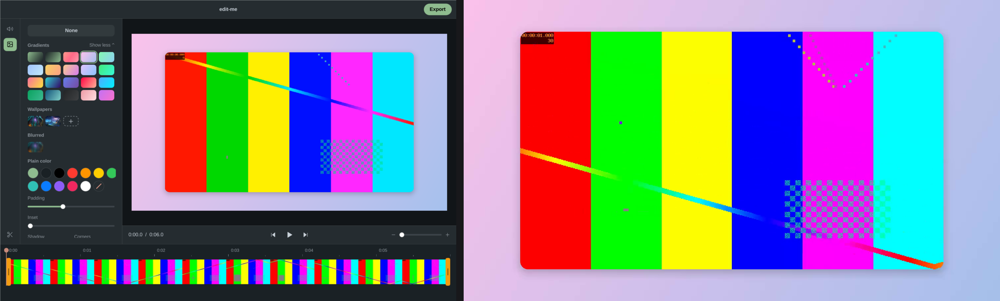

# Screen recording (M4), as CleanShot did it before Studio Mode

The product owner's brief (2026-10-09): CleanShot X's recording as it was before Studio Mode. Record a window, the full screen or one display, with an optional microphone and an optional camera (its size and shape chosen, and moved during the recording). Record video or a GIF. After saving, an editor to cut, trim, save, merge and mute audio. No Studio Mode: no automatic zooms (D3).

Sources: the six research reports in [research/recording-2026-10/](../research/recording-2026-10/README.md). The CleanShot facts come from its own 4.7.6 and 4.8.11 app files ([cleanshot-x-4-recording.md](../research/recording-2026-10/cleanshot-x-4-recording.md)). Spec: REC-01…15, VED-01…03. Decisions: D3, D6, D43–D47, D49.

## What CleanShot 4.x does, and what Snip does

| | CleanShot 4.x (before Studio Mode) | Snip |
|---|---|---|
| **Start** | Menu "Record Screen"; a hotkey that also stops (none by default); the URL API | Snip's menu (Record Screen / Stop Recording), `snip record`, the `record` action in Settings › Shortcuts (no default key yet; spec §7 proposes ALT+PRINT, an open question) |
| **What** | Drag an area; **Space** snaps it to a window; ⤢ or Return with no area records the display | The same (D49): the panel shows at once over the whole output; a drag draws an area (handles resize it, a drag inside moves it), Space then a click picks a window, ⤢ goes back to the whole output, W × H types a size. `snip record area\|fullscreen` for scripts |
| **Panel** | Settings, W×H, ⤢, Select area / Microphone (with a level meter), Computer audio, Camera, Highlight Clicks, Show Keystrokes / **Record GIF ⌥↩**, **Record Video ↩** | The same, without the level meter; centred on the screen, then in the area's middle (beside it when it doesn't fit), gone before the first frame |
| **Before it starts** | Optional 3-2-1 countdown (off by default), dim outside the area (on), Do Not Disturb (off) | Countdown (3 s by default), dim outside, Omarchy's DND on while recording, the earlier state restored |
| **While recording** | A pill: stop with the time and a level meter, pause/resume, restart and delete (each asks first), a drag grip | Stop with the time, pause/resume, restart and delete (each asks first, in the pill); **outside the area**, since KMS capture records whatever is on screen (macOS left CleanShot's pill out of the capture). Hidden for a whole-output recording, where the menu and `snip record stop` stop it. No level meter yet |
| **After** | Quick Access card (length, size, sound); double-click opens the editor; a GIF is made after Stop | The same card (first frame, length); double-click or Edit Video… opens the editor; a GIF is made after Stop. Its corners (D51): close, **Quick Look** (a small window that plays it; Space too), the editor, **Open With…** where CleanShot has its cloud |
| **Editor** | Trim (in and out only), dimensions, quality (7 steps), audio: as is / mono / mute / volume 0–200 %, Trim Only or Trim & Convert, **Replace** or **Save as New**, an estimated size | Trim, **cuts in the middle** (Split at the playhead, Cut a part), each track's volume (0 mutes it; several are mixed into one), mono, MP4 or **GIF**, quality (4 steps) and size, Replace or Save as New, an estimated size |
| **Camera** | Devices; Small/Medium/Large/Huge (scaled to the area); Circle/Square/Rectangle/Vertical; mirrored by default; drag anywhere, any time; a click fills the area | The same, from the panel's Camera menu (below) |
| **Clicks, keys** | Highlight clicks (size, colour, outline or filled, animated); keystrokes (size, 6 positions, dark or light, command keys only by default) | Two toggles on the panel: a ring in the theme's accent (right click: warning) where the pointer clicks; the command keys at the bottom centre of the area, held modifiers kept, repeats counted (×2). Command keys only, no options yet |
| **Safety** | Crash recovery; a low-disk warning (no auto-stop); mic muted or unplugged: Continue Without Audio or Stop; display sleep prevented | Recovery at start; **stops and keeps** below 1 GB free or when its display goes away; the screen kept awake; **paused** when the session locks; a muted microphone flagged on the panel |

Snip goes beyond CleanShot 4.x in two places, both asked for: cuts in the middle and GIF export in the editor ("cut things up"), and mixing the tracks with their own volumes in the editor ("merge audio, mute audio"; CleanShot asked for each track's volume in a dialog after recording).

## As built (2026-10-09)

The panel (D49, 2026-10-10), at once over the whole screen, then in the middle of a dragged area (its handles resize it):



Recording: the frame turns red; the controls sit outside the area.



The camera (a test card stands in for one): its menu; Large and Vertical; a click fills the area; while recording.



Highlight Clicks and Show Keystrokes: the two toggles; while recording, a ring where it clicked and the keys pressed.



A recording's card (D51): close and Quick Look on top, the video editor and Open With… below; Quick Look plays it in a small window.



Snip's icon in the bar while it records (live, on DP-2; the bar is dimmed as everything outside the area is): before, recording, after.



The video editor, laid out as CleanShot 5's (D50): two splits, the middle part cut (dimmed, "3.5 s"), a trim (the orange handles), the last part selected.



Its Background section (VED-06): a gradient, 16:9, padding and rounded corners; then a frame of the export.



## How it works

```
Record Screen ─▶ record_open ─▶ HUD layer "snip-record" (QML): the panel; frame, dim, handles; countdown, controls
                    └─ the area, a window (Space) or the output, chosen on the panel
                      └─ Record ─▶ record_start (the area) ─▶ record_go (engine/record.rs)
                                     ├─ gpu-screen-recorder (KMS, NVENC) ─ IPC socket: pause, stop
                                     ├─ record_watch: first frame (.ts), exit, free disk
                                     └─ Stop ─▶ the file ─▶ GIF? ─▶ history (a rename) ─▶ card
history card ─ Edit Video… ─▶ VideoEditor window ─▶ media::export (ffmpeg) ─▶ Replace or a new capture
```

**gpu-screen-recorder 6.1** records, as Omarchy's own recorder does (D6):
- `-w WxH+X+Y` in global logical pixels (or `-w DP-2` for a whole output), `-c mp4 -k auto -q very_high -f 60 -fm cfr -cursor yes`.
- Sound: `-a "default_output|<mic>"` for one mixed track, or one `-a` per track; AAC.
- `-ipc <socket>` for pause and stop; `stop` answers once the file is finished.
- `-write-first-frame-ts yes`: the timer starts at the first frame. gsr takes 0.35–0.5 s to start, after the countdown: until its first frame the HUD shows "launching", not "recording". (A paused pre-roll during the countdown would hide it, but gsr lets one frame through before it applies the pause: [review](../research/recording-2026-10/review.md) C1.)
- `-fallback-cpu-encoding yes`: x264 when the graphics card's encoder can't start. `-s` (the largest size) only when the area is bigger: gsr scales up to fit too.
- At stop, gsr stops first; only then do the HUD, the desktop cover and the hooks go, so none of them is in the last frames.
- `-ffmpeg-opts flush_packets=1;frag_duration=1000000`: a killed recorder leaves fragments Snip recovers (checked live: 116 of about 150 frames back after a SIGKILL).
- `-exclude-metadata yes`: no device names in the file.
- It runs by its full path in its own process group, so Omarchy's indicator, ALT+PRINT and its menu never see or stop it (D44). Its messages go to a log file, never a pipe: with Snip gone, a write to the pipe would kill it mid-save.
- Areas under about 160×128 physical pixels go to the CPU encoder: NVENC refuses or pads them.

**Out of the shot.** Snip's cards step aside while the panel is up and while it records (KMS would record them). With Hide desktop clutter on, the bars show the wallpaper and the pins step aside too, as for screenshots (CAP-12).

**Files.** A take is written in `~/.local/share/snip/recording/` (on disk, beside history; the runtime dir is a RAM disk) and moved into history when it stops. Save copies it to `[recording] export_dir` (`~/Videos/Screencasts`).

**Safety (REC-14, D47).**
- A take still in `recording/` when Snip starts was cut short: a crash, or the service stopping (systemd's SIGTERM lets gsr finish its file). It goes into history with its card. A file of fragments is rebuilt first (`-ignore_editlist 1`).
- Below 1 GB free, the recording stops and is kept; gsr itself would go on "recording" and write nothing.
- When its display is unplugged the recording stops and is kept; gsr would go on encoding the last frame.

**The editor (VED-01…03).**
- The editor opens at once; ffmpeg's frames for the timeline fill it a moment later.
- Qt Multimedia plays the recording, decoding in software. Snip names the FFmpeg device lists at start; without them, QtMultimedia probed every hardware decoder on the GUI thread and Snip took 0.87 s to start instead of 0.3 s.
- One seek runs at a time, the newest waiting, so the picture follows a drag along the timeline. Frame steps go to a frame's middle.
- Export: the frames are made regular (`fps=`), and each kept part is trimmed and joined (`trim`/`atrim` + `concat`), every cut on a frame. This is exact, where `select` left frames over and the sound up to 43 ms off. A GIF takes two passes, the palette first, since one pass held every frame in memory.

**Tests.** KMS capture can't see the nested Hyprland the e2e suite runs in, so `SNIP_RECORDER=fake` makes ffmpeg's test pattern the recording: the suite checks Snip's side (areas, timing, pause, GIF, the HUD, the editor, recovery, the disk check). Real gsr is checked by hand on a tiny area of the live screen.

## Slices

| Slice | Spec | Status |
|---|---|---|
| Videos and GIFs in history: cards, preview, Copy, Save, History's filters | REC-12/13, HIS-01 | ✅ built |
| Recording: area, window, output; a toolbar (Video/GIF, mic, system audio; the panel replaced it, D49); countdown; controls; DND; `snip record` | REC-01…05, 07, 11–13, API-01 | ✅ built |
| CleanShot's panel at once: the area chosen on it (drag, handles, W × H, ⤢, Space for a window), Record GIF and Record Video | REC-01/02, D49 | ✅ built |
| Settings › Recording; Record Screen in Snip's menu | REC-06 (part), REC-12/13 | ✅ built |
| Video editor: split, cut, trim, track volumes, mono, MP4 or GIF, Replace or Save as New | VED-01…03 | ✅ built |
| The editor in CleanShot 5's layout; a background around the recording, drawn into the export | VED-01, VED-06, D50 | ✅ built |
| Safety: recovery, low disk, display unplugged | REC-14 (part) | ✅ built |
| Camera bubble | REC-08 | ✅ built; a real camera is untested (none here) |
| Click highlights and keystrokes | REC-09/10 | ✅ built; real typing into the hook is untested (the nested Hyprland has no keyboard of ours) |
| Restart and Delete ask first; Alt+Enter records a GIF | REC-05, REC-02 | ✅ built |
| The screen kept awake; paused when the session locks; a muted microphone flagged | REC-14 | ✅ built; the lock is untested (the nested Hyprland can't lock) |
| Snip's bar icon turns red while recording (a click opens the menu: Stop Recording) | REC-06 | ✅ built (checked live: the bar's tray follows the icon change) |
| A level meter; the time in the bar; a microphone unplugged mid-recording; the Bluetooth headset warning | REC-05, REC-06, REC-14 | planned |
| Editor: a scrubbing proxy, keyframe thumbnails at once, a smooth playhead | VED-01 | planned |
| Privacy-safe mode; true window capture | REC-15, P2 | later |

## Camera bubble (REC-08)

- **Where:** inside the HUD layer, which already covers the output: no new window and no window rules. It sits inside the recorded area, so it is recorded as seen, and its own input region lets it be dragged before and during the recording.
- **Look:** Circle (default), Square, Rectangle, Vertical. Small, Medium, Large, Huge, scaled to the recorded area (Omarchy's sizes are 18, 25 and 33.75 % of its height). 40 px from the bottom-right corner to start; dragged anywhere after. Mirrored by default. A click fills the area with the camera; another click brings it back.
- **Camera:** Qt opens V4L2 devices directly (no PipeWire path in Qt 6.11). The bubble picks an uncompressed format of at most about 640×480: Qt decodes MJPEG on the CPU, up to 23 % of a core at 1080p. It hides itself if the camera fails, is in use, or stops sending frames, since whatever it shows is recorded.
- **Settings:** the camera (by its name), shape, size and mirror are kept in `[recording]`; where it was dragged is kept for that recording only.
- **Tests:** there is no camera on the reference machine. `SNIP_CAMERA=fake` puts a test card in the list (e2e: the menu, sizes, shapes, the circle's mask on screen, the drag, the fill, recording). The device path (V4L2 formats, unplugging, "in use") needs a real camera.

## Clicks and keystrokes (REC-09/10)

- **Source:** Hyprland's Lua hook `hl.on("input.keyboard.key")` for keys and a non-consuming `mouse:272/273` bind with a modmask nobody uses for clicks. They are installed at record start, removed at stop, and removed by a Lua timer if Snip's heartbeat stops. The full module is in [hyprland-clicks-keys-windows.md](../research/recording-2026-10/hyprland-clicks-keys-windows.md) §5.
- **Transport:** socket2 `custom>>snip:<session>:…` events, which Snip already reads.
- **Privacy:** the hook sees every key, password fields and the lock screen included. By default only command keys are shown (modifiers, and keys pressed with Ctrl, Alt or Super). Nothing is shown while a private window (1Password, Bitwarden) or the polkit prompt has focus, or while the screen is locked.
- **Drawing:** in the HUD layer, inside the area, so they are recorded. A click outside the area draws nothing (it isn't recorded); paused, nothing is sent.
- **Tests:** the Lua module passes the research's mock of Hyprland 0.56.2's Lua (32 checks: install twice, the command-key filter, clicks, mute, the watchdog, a config reload, the user's own SUPER+drag bind left alone). In the nested e2e, real clicks go through the hook; keys come as the hook sends them, since no real keyboard types there.

## What the review left open

The [review](../research/recording-2026-10/review.md) (06:05, against the code then) found these still to do:
- e2e can't see what ends up in a video: the test recorder makes its clip at Stop. A stub that grabs the nested output (grim) would show the camera, rings and keys are in it and the controls aren't.
- A display gsr can't record (HEADLESS-1) is still offered: a preflight against `gpu-screen-recorder --list-monitors` would grey it out.
- An area's size is rounded where gsr truncates, so an odd width can get a black column.
- The saved microphone is a PipeWire node name, which changes with the card's profile.
- Hyprland's event connection isn't reconnected if it drops (64 queued events): keys would stop until Snip restarts.
- gsr 6.1.3 is in Arch: it flushes the last frames at stop and aligns audio differently; the timings here are 6.1.0's.

## Open questions for the product owner

1. Countdown: 3 s by default now; CleanShot's default is off.
2. The record key: ALT+PRINT (spec §7) is Omarchy's own recorder's key. Offer it with the other PRINT keys (an opt-in), or leave recording without a default key?
3. Recordings folder: `~/Videos/Screencasts`. Should `OMARCHY_SCREENRECORD_DIR` win when it is set?
4. Bar: Snip's menu icon becomes the stop button with the time while recording (recommended), or a bar plugin?
5. Lock during a recording: pause the recording (recommended), or only hide keystrokes?
6. Keystrokes: command keys only by default (recommended), or all keys?
7. Camera: mirrored by default, as CleanShot does?
