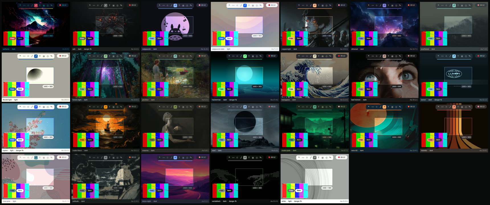
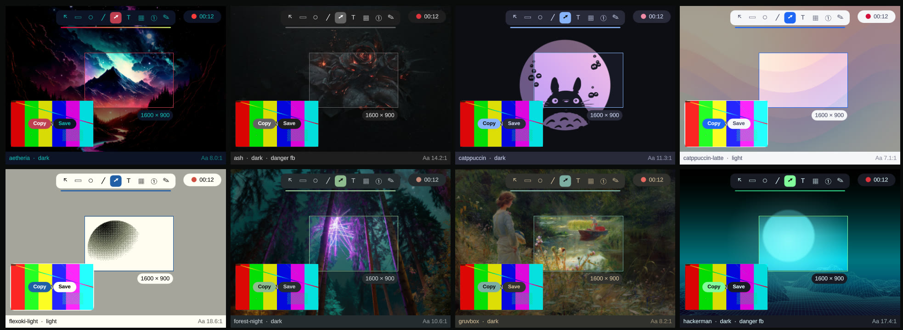

# Spike S03: Omarchy theme tokens (S17) and hide-desktop cover (S15)

Date: 2026-10-06. Code: [`spikes/s01-foundation/`](https://github.com/InsaneArts/snip/tree/1b9ab47a31056383be0a7b2a2d4506ceb580fa36/spikes/s01-foundation) (removed later; the link is the last commit with it) (`rust/src/theme.rs`, `--gallery`, `--cover`, `s15_cover.py`).

## S17: theme tokens across every installed theme. ✅ PASS

**Built:**
- A Rust theme service resolves each installed theme (26: system plus `~/.config/omarchy/themes`).
- It uses **Omarchy's own resolver** (`omarchy-theme-color --all`), so palette values match every other themed app.
- It parses the theme's signature gradient (`hyprland_active_border`) and finds its wallpaper.
- It derives the design-doc tokens (surface, text, accent, on-accent, scrim, and danger/success/warning picked by hue) with the **contrast guard**.
- A `--gallery` mode renders Snip components in every theme over the theme's own wallpaper:
  - selection with scrim, size pill and accent border;
  - toolbar with the selected tool;
  - signature gradient;
  - recording pill;
  - QAO card with Copy and Save.

**Results**
- **Text contrast passes in all 26 themes without adjustment.** The minimum is 6.7:1 (rose-pine), against a 4.5:1 target. The guard is still needed for user themes.
- **Semantic colours must be picked by hue (confirmed).** Omarchy's resolver is ANSI-slot based. In Aetheria it resolves `red` = `#c8e967` (lime) and `green` = `#E20342` (red). Hue picking gives the right red for the record dot.
- **6 monochrome themes have no usable saturated red** (ash, hackerman, lumon, lupine, vantablack, white). They correctly get the fixed fallback red.
- **On-accent text** (black or white by contrast) works. For example, hackerman's bright green accent gets dark text.
- **Light themes** (catppuccin-latte, flexoki-light, lupine, rose-pine, white) get light surfaces and lighter scrims. Nothing is hard-coded dark.
- **Cost:** resolving all 26 themes through the bash resolver takes **about 165 ms**. That's fine for the Background tool's theme list, but too slow for the hot path. The product resolves only the current theme at start-up and on theme change (about 6 ms), caches the rest, and may port the resolver to Rust later.

**Bug found: the QScreen ownership crash**
- **Symptom:** Snip segfaulted in `QWaylandWindow::devicePixelRatio()` (null `QPlatformWindow::screen()`) whenever a window was mapped after a large JS allocation.
- **Cause:** a `Q_INVOKABLE` returned a parentless `QScreen*` to QML. QML took **JavaScript ownership**, and the GC later `deleteLater()`'d **Qt's real QScreen**. Every window lost its screen, and the next map dereferenced null.
- **Diagnosis path:**
  1. timing, size, keyboard-mode and content bisection all ruled out;
  2. per-window screen pointers went null within 20 ms of a big `JSON.parse`;
  3. a gdb breakpoint on `QScreen::~QScreen` caught the destruction coming from `QObject::event(DeferredDelete)`.
- **Fix:** `QQmlEngine::setObjectOwnership(obj, QQmlEngine::CppOwnership)` before returning any C++-owned `QObject*` to QML.
- **Product rule:** every C++/Rust-owned object exposed to QML is explicitly C++-owned. A unit test asserts this for each exposed object. Added to the risk register.

## S15: hide desktop clutter (wallpaper cover over the bar). ✅ visually seamless; ⚠️ not bit-exact

**Built:** `--cover`, a layer surface on the **overlay** layer:
- anchored top, left and right, `exclusionZone -1`;
- its height is the bar's height, read from `hyprctl layers` (`omarchy-bar`, 2752×35 logical);
- it shows the current wallpaper (`~/.local/state/omarchy/current/background`) through **the same QML Image pipeline omarchy-shell uses**: `PreserveAspectCrop` on a full-output-sized item, clipped to the bar strip.

The bar keeps its reserved space, so **windows never re-layout**.

**Verification** (`s15_cover.py`, on an empty temporary workspace): ground truth is the wallpaper with the bar hidden, compared with the cover.

| Variant | Bar strip PSNR | Pixels differing | Max Δ | Seam (rows 42–45) max Δ |
|---|---|---|---|---|
| default (smooth) | 46.0 dB | 27k of 151k | 48 | 32 |
| **mipmap** | **46.3 dB** | **16k** | 50 | 38 (981 px) |
| no smooth | 36.8 dB | 24k | 141 | 54 |

- **Above about 40 dB PSNR the difference is not visible.** The cover strip is indistinguishable from the real wallpaper by eye.
- It is not bit-exact, because omarchy-shell (Quickshell) draws the wallpaper through its own render pipeline: its backend, buffer scale and texture path. **Decision: use `mipmap: true`** (closest), and accept "visually seamless".
- For **screenshots**, the product can instead apply the cover to the frozen frame's pixels. The visual result is the same, and no live surface is needed.
- For **recordings**, the live cover surface is the way.

**Findings about Omarchy itself (relevant to the product)**
- `omarchy-toggle-bar on` sets the `bar-off` flag, so it **hides** the bar; `off` shows it.
- Toggling the bar off and on quickly **strands the bar off-screen**: the shell's file watcher misses changes, which Omarchy's own script comments warn about, and `syncHidden` didn't always recover it within 1.5 s.
- This confirms the design choice: **never hide the bar by toggling it**. Cover it.
- `hyprctl layers` reported the visible bar at y = -35 after a toggle cycle. Don't rely on the layer's `y` to decide visibility.
- The test left the bar visible, as it found it.

**Observed, not yet explained:** in one run the whole screen differed between two captures a few seconds apart by Δ≤4. A night-light (hyprsunset/CTM) transition baked into captures is the likely cause. The platform research's checklist already includes "night light in captures", so it stays open for the recording spikes.

## Doc changes
- Design doc §3: semantic colours by hue are confirmed. Resolver timing noted.
- Product CAP-12: "visually seamless (PSNR ≈ 46 dB); bit-exact not guaranteed". Screenshots apply the cover to the frozen frame.
- Risk register: **R25**, C++ objects returned to QML must be C++-owned.
